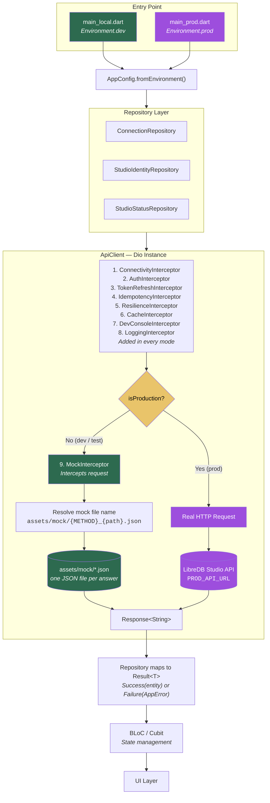
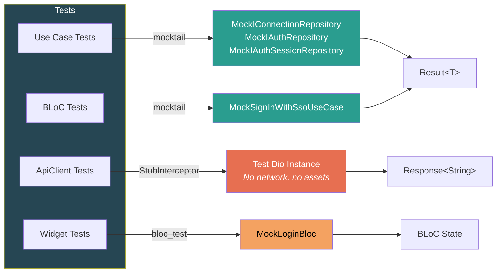

# Mock Data Architecture

This document explains how the project handles real API calls vs. local mock data, how mock JSON files are structured and resolved, and which tests use the mock data and which bypass it with test doubles.

## Overview

The project supports three runtime modes through a single interceptor-based design:

| Mode | Entry Point | Mock Data | Network | Latency |
| --- | --- | --- | --- | --- |
| **Development** | `main_local.dart` | Yes (interceptor) | None | 500 ms simulated |
| **Test** | `Environment.test` | Yes (interceptor) | None | 0 ms |
| **Production** | `main_prod.dart` | No | Real API | Real |

Switching between modes requires **zero code changes** in repositories or BLoCs — only the entry point differs.

## Architecture Diagram



### Test Layer (Test Doubles)



## Interceptor Chain

The Dio HTTP client is created in `lib/infrastructure/http/api_client.dart`.
`ApiClient._createDio()` pairs each interceptor with its descriptive metadata; without that metadata, the chain is:

```dart
dio.interceptors.addAll([
  ConnectivityInterceptor(),                      // rejects requests while offline
  AuthInterceptor(secureStorage: _secureStorage), // attaches the JWT
  TokenRefreshInterceptor(                        // refreshes expired access tokens
    dio: dio,
    onSessionExpired: _onSessionExpired,
    secureStorage: _secureStorage,
    refreshDioFactory: _appConfig.isProduction ? null : _mockRefreshDio, // see "Token refresh" below
  ),
  IdempotencyInterceptor(),                       // opt-in Idempotency-Key for POST/PUT/PATCH
  ResilienceInterceptor.instance.forDio(dio),     // retry + circuit breaker
  CacheInterceptor(),                             // GET response caching with TTL
  DevConsoleInterceptor(),                        // records requests in debug builds
  LoggingInterceptor(),                           // request/response logging
  if (!_appConfig.isProduction) MockInterceptor(appConfig: _appConfig), // dev + test only
]);
```

Only `MockInterceptor` depends on the environment: it is added outside production, as the last entry, and to the Dio that sends the token refresh.
It sits last because it stands in for the server: it resolves with `callFollowingResponseInterceptor: true`, so its response still runs through the `onResponse` handlers of the interceptors above it (cache, dev console, logging), as a real response would.
When it answers a protected request without a token with 401, it rejects with `callFollowingErrorInterceptor: true`, so the `onError` handlers run as they do for a server 401: `TokenRefreshInterceptor` refreshes the token, or ends the session when the token cannot be refreshed, and the dev console and logging record the failure.

`ConnectivityInterceptor` rejects with `callFollowingErrorInterceptor: true` as well when `ConnectivityService` reports the device offline, so the `onError` handlers run as they do for a request that cannot connect: `CacheInterceptor` answers a GET from its cache with an `x-cache: stale` header (`x-cache: hit` for a fresh `cacheFirst` entry, as online), and the dev console and logging record a request it cannot answer.
The error of that rejection is a `ConnectivityException`, so `ResilienceInterceptor` neither retries it nor counts it against the endpoint's circuit breaker: the request was never sent.
`ResilienceInterceptor` rejects a request to an endpoint whose circuit is open with `callFollowingErrorInterceptor: true` too, so the dev console and logging record it; `CacheInterceptor` does not answer it, so a GET fails with `CircuitBreakerOpenException` even when a response is cached.
A GET with `CachePolicy.cacheOnly` never reaches the network, so neither the offline check nor an open circuit stops it, and `CacheInterceptor` answers it from the cache.
When `CacheInterceptor` answers a GET that went out and failed, it ends the error chain before the dev console sees the failure, so it completes the dev console entry itself (`DevConsoleInterceptor.recordAnswer`): the entry shows the cached answer and the error it answers.

### AuthInterceptor

Reads the JWT from `ISecureStorage` on every request to a private path on the API origin and adds it as a Bearer token when one is stored.
A request to a public endpoint (see [Public vs. Private Endpoints](#public-vs-private-endpoints)) never gets a token.
Dio sends a request whose path is an absolute URL to that URL instead of to the base URL, so a path a server supplies can name any host.
`isApiOriginRequest` in `lib/infrastructure/http/api_origin.dart` compares the scheme, host and port of the request with those of the base URL, and a request to another origin never gets a token either: `AuthInterceptor` removes an `Authorization` header already on it and records no session generation for it.
A relative path with an empty base URL, as in dev/test mode, counts as the API origin, so `MockInterceptor` still sees the token:

```dart
if (isPublicEndpoint(options)) {
  handler.next(options);
  return;
}
if (!isApiOriginRequest(options)) {
  options.headers.remove('Authorization');
  handler.next(options);
  return;
}
options.extra[sessionGenerationKey] = SessionGeneration.current;
String? jwtToken;
try {
  jwtToken = await _secureStorage.read(SecureStorageKeys.jwtToken.key);
} catch (e) {
  _log.warn('secure read failed for {}; sending request without Authorization: {}', [options.path, e]);
}
final hasAuth = jwtToken != null && jwtToken.isNotEmpty;
if (hasAuth) {
  options.headers['Authorization'] = 'Bearer $jwtToken';
}
```

This runs **before** MockInterceptor so that mock auth checks see the token.

### MockInterceptor

This is the core of the mock system.
In dev/test mode it answers every request that reaches the end of the chain with a response loaded from a local JSON file, so the request never leaves the device.

**Step-by-step flow:**

1. **Simulated latency** — 500 ms delay in dev mode, skipped in test mode
2. **Auth check**: for a request to an endpoint that is not public, rejects with 401 if no `Authorization` header; on a LibreDB Platform path (under `/v1/`) the body is Platform's envelope `{"error":{"code":"BEARER_INVALID",...}}`, elsewhere Studio's plain text
3. **Status code** — POST → 201, DELETE → 204 (early return), everything else → 200
4. **File resolution** — Builds a file name from the request metadata (see next section)
5. **Asset loading** — Reads the JSON file via `rootBundle.loadString()`
6. **Missing file**: if the file cannot be loaded, rejects with 501 Not Implemented and `callFollowingErrorInterceptor: true`, with an error that names the file, so the dev console, the log and the caller's error all show which file to add

A GET, POST, PUT or PATCH the mock has no file for fails instead of getting a made-up success; DELETE needs no file and always answers 204.

The LibreDB Platform client (`PlatformApiClient`) runs the same chain with the same mock: dev and test builds carry a Platform target without a base URL, so `GET /v1/me` reads `assets/mock/GET_v1_me.json`.
Its answers are never cached (every `/v1/` path is `networkOnly`), and a coded Platform answer is never retried ([http-client.md](http-client.md#libredb-platform)).

### LoggingInterceptor

Logs the method and URI of each request, and the status code and body length of each response, via `AppLogger`.
Always runs, in every mode.

### Token refresh

`TokenRefreshInterceptor` refreshes through the `TokenRotation` it is given, a `refresh_token` grant at the identity provider's token endpoint, never through the API, so a 401 on the refresh cannot come back into the chain.
In mock mode the provider is `LocalOidcClient`, the debug-only double of `main_local.dart` ([oidc.md](oidc.md)), which answers the refresh with new tokens; the request that got the 401 is sent again with the new token, and the session continues, as it does against the server.

`AuthInterceptor` records on each request the session generation it goes out under, before it reads the token (`SessionGeneration` in `lib/infrastructure/storage/session_generation.dart`).
A logout or the end of the session wipes the stored session inside `SessionGeneration.wipe`.
So a 401 for a request whose session has been wiped since, or is being wiped, is neither sent again nor refreshed: the token stored now may be that of another user who signed in since.
A refresh still on its way drops the rotated tokens instead of storing a session that a relaunch would restore.
The startup step refreshes through the same rotation and goes on after its time limit, so before it acts on the answer of a refresh, success or failure, `TokenRefreshInterceptor` also reads the stored refresh token again.
When the session is no longer stored, the answer is dropped; when another refresh has rotated the session, its tokens stay and the request is sent again with its JWT.
`CacheInterceptor` checks the same generation before it stores a response, so a GET still on its way when the session ends does not put the data of the user who signed out back into the cache the wipe cleared.

## Mock File Naming Convention

Mock JSON files served by `MockInterceptor` live in `assets/mock/` and follow a strict naming pattern:

```
{HTTP_METHOD}{path_with_underscores}[_pathParams|_queryParams].json
```

**Path transformation rules:**
- `/` → `_`
- `-` → `_`

**Examples:**

| Request | Mock File |
| --- | --- |
| `GET /auth/me` | `GET_auth_me.json` |
| `GET /connections/managed` | `GET_connections_managed.json` |
| `POST /db/query` | `POST_db_query.json` |
| `POST /db/test-connection` | `POST_db_test_connection.json` |
| `DELETE /items/{id}` | *(no file needed, returns 204 directly)* |

**How the file name is resolved** (from `MockInterceptor`):

```dart
final basePath = options.extra['_basePath'] ?? options.path;
final hasPathParams = options.extra['_pathParams'] != null;
final hasQueryParams = options.extra['_queryParams'] != null;
final filePath = basePath.replaceAll('/', '_').replaceAll('-', '_');

if (hasPathParams) {
  mockFileName = '${options.method}${filePath}_pathParams.json';
} else if (hasQueryParams) {
  mockFileName = '${options.method}${filePath}_queryParams.json';
} else {
  mockFileName = '${options.method}$filePath.json';
}
```

The `_basePath`, `_pathParams`, and `_queryParams` metadata are injected by `ApiClient` into `options.extra` so the interceptor can distinguish between `/items` (list) and `/items/123` (single item).

`POST /db/transaction` is read by the body's `action`, because Studio answers each action in its own shape: `begin` reads `POST_db_transaction_begin.json`, and `query`, `commit`, `rollback` and `status` read theirs the same way.
A request to it without a string `action` finds no file and gets the 501.

## Mock JSON File Structure

Each file contains the exact JSON the real API would return.

**Single object** (`GET_auth_me.json`):
```json
{
  "authenticated": true,
  "user": {
    "role": "admin",
    "username": "admin@example.com",
    "idpSubject": "6f1c9a52-0d7e-4b8e-9f43-2b0c4b1f7a10",
    "idpIssuer": "https://localhost:8443/realms/libredb",
    "iat": 1792620000,
    "exp": 1792620060,
    "channel": "bearer"
  }
}
```

**List** (`GET_connections_managed.json`):
```json
{
  "connections": [
    { "id": "seed:sales-postgres", "name": "Sales (PostgreSQL)", "type": "postgres", ... },
    ...
  ]
}
```

There is no token file: the sign-in and the token refresh go to the identity provider, which `LocalOidcClient` stands in for in mock mode.

## Public vs. Private Endpoints

`publicEndpoints` in `lib/infrastructure/http/public_endpoint.dart` lists the API endpoints that serve requests without a session, each by HTTP method and path:

| Method | Path | Sent by |
| --- | --- | --- |
| `GET` | `/health` | Studio's liveness check, at start and on a return to the foreground after more than 5 minutes away, `StudioStatusRepository.liveness` |
| `GET` | `/ready` | Studio's readiness, `StudioStatusRepository.readiness` |

The path is the one the `ApiClient` method is called with, before any path parameters.
Another method on the same path is private, and the app's own routes, such as `/login`, are not API endpoints, so the list leaves them out.
All other endpoints require a valid `Authorization` header.
In dev/test mode the `MockInterceptor` enforces this check; in production the real API does.

`AuthInterceptor`, `TokenRefreshInterceptor` and `MockInterceptor` all ask `isPublicEndpoint`, so they cannot disagree about an endpoint:

- In every environment `AuthInterceptor` sends no token to a public endpoint, so a stale token left by an expired session never reaches it.
- `TokenRefreshInterceptor` passes a 401 from a public endpoint on without a token refresh and without ending the session, because it is not about a session.
- `MockInterceptor` answers a public endpoint without a token, as the server does.

`TokenRefreshInterceptor` also asks `isApiOriginRequest`: a 401 from another origin than the API's is passed on with no token refresh, no retry and no session end, because `AuthInterceptor` sent no token there and sending the request again would carry the refreshed one.

## How Repositories Use ApiClient

Repositories are **completely unaware** of whether they are running against mock data or a real API.
They receive the shared `ApiClient` through their constructor and always call it:

```dart
class ConnectionRepository implements IConnectionRepository {
  ConnectionRepository(this._apiClient);

  final ApiClient _apiClient;

  @override
  Future<Result<List<StudioConnection>>> listManaged() async {
    try {
      final response = await _apiClient.get('/connections/managed');
      return Success(ManagedConnections.fromJsonString(ApiClient.decodeUTF8(response.data!)));
    } catch (e) {
      return Failure(studioError(e));
    }
  }
}
```

In dev mode `MockInterceptor` answers `GET /connections/managed` with `GET_connections_managed.json`.
A `pathParams` argument makes `ApiClient` append the value to the URL and store `_basePath` and `_pathParams` in `options.extra`, so `MockInterceptor` resolves `{METHOD}_{basePath}_pathParams.json`.
A `queryParams` argument resolves `{METHOD}_{basePath}_queryParams.json` the same way.

## Test Layer

Most tests do **not** use the mock interceptor.
They replace a layer with a test double instead:

```
┌──────────────────────────────────────────────────────────────────┐
│                        Test Layer                                 │
│                                                                   │
│  Use Case Tests:   MockIConnectionRepository (interface mock)    │
│  BLoC Tests:       MockSignInWithSsoUseCase (use case mock)      │
│  ApiClient Tests:  _StubInterceptor (Dio-level stub)             │
│  Widget Tests:     MockBloc (bloc_test)                          │
└──────────────────────────────────────────────────────────────────┘
```

Two common setups do run the mock interceptor.
`TestEnv.apiClient()`, which repository tests use, builds an `ApiClient` with `AppConfig.test()`, so `MockInterceptor` serves `assets/mock/*.json` without the simulated latency.
Passing a stub `dio` to it replaces the whole chain, `MockInterceptor` included.
A test that pumps the whole `App` with `LocalSignInDependencies()`, such as `test/integration/app_smoke_test.dart`, runs with `AppConfig.dev()` and the local sign-in, as `main_local.dart` does.

### Use Case Tests

Mock the repository interface directly. No HTTP involved:

```dart
class MockIConnectionRepository extends Mock implements IConnectionRepository {}

test('returns the managed connections', () async {
  when(() => mockRepo.listManaged()).thenAnswer((_) async => const Success(connections));

  final result = await ListManagedConnectionsUseCase(mockRepo).call();
  expect(result, isA<Success<List<StudioConnection>>>());
});
```

### BLoC Tests

Mock the repository (or use case) and verify state transitions:

```dart
blocTest<ConnectionListBloc, ConnectionListState>(
  'emits [loading, loaded] when the list loads',
  setUp: () => when(() => mockRepo.listManaged()).thenAnswer((_) async => const Success(connections)),
  build: () => ConnectionListBloc(listManagedConnectionsUseCase: ListManagedConnectionsUseCase(mockRepo)),
  act: (bloc) => bloc.add(const ConnectionListRequested()),
  expect: () => const [ConnectionListLoading(), ConnectionListLoaded(connections: connections)],
);
```

### ApiClient Tests

`ApiClient` is constructed via dependency injection — there is no global
singleton or `setTestInstance`. Inject a custom `_StubInterceptor` through the
`dio` parameter to simulate transport errors:

```dart
setUp(() {
  stub = _StubInterceptor();
  final testDio = Dio(BaseOptions(baseUrl: 'https://test.api', responseType: ResponseType.plain));
  testDio.interceptors.add(stub);
  client = ApiClient(appConfig: const AppConfig.prod(), dio: testDio);
});

test('maps 401 to UnauthorizedException', () async {
  stub.stubDioError(DioExceptionType.badResponse, statusCode: 401);
  expect(() => client.get('/endpoint'), throwsA(isA<UnauthorizedException>()));
});
```

### Test Bootstrap

Cross-cutting test setup is centralized in `test/flutter_test_config.dart`
(auto-discovered by `flutter test`), which runs once-per-isolate config and an
automatic per-test environment reset via `TestEnv` (`test/support/test_env.dart`).
Individual test files need no manual storage/router/secure-storage setup; use
`TestEnv.authenticate()` (in `setUp`/test body) for auth-dependent tests and
`TestEnv.apiClient({Dio? dio})` for the mock-backed client.

See [`testing-architecture.md`](testing-architecture.md) for the full test
structure, bootstrap, opt-out mechanism, and per-layer test patterns.

## Adding a New Mock Endpoint

When you add a new API endpoint, follow these steps:

1. **Create the mock JSON file** in `assets/mock/` following the naming convention:
   ```
   GET_your_endpoint.json              — for GET without params
   GET_your_endpoint_pathParams.json   — for GET with path params
   GET_your_endpoint_queryParams.json  — for GET with query params
   POST_your_endpoint.json             — for POST
   PUT_your_endpoint.json              — for PUT
   ```

2. **Register the asset** in `pubspec.yaml` (already covered by `assets/mock/` glob).

3. **If the endpoint is public**, add its method and path to `publicEndpoints` in `lib/infrastructure/http/public_endpoint.dart`.

4. **Call `ApiClient`** from your repository — the mock interceptor handles the rest automatically.

5. **Drive the new repository method** in `test/architecture/mock_asset_coverage_test.dart`.
   That test sends every repository method through the mock-backed client and fails when a method is not listed or its file is missing.

No changes to `MockInterceptor` or `ApiClient` are needed.
A GET, POST, PUT or PATCH whose file is missing fails with 501 and the name of the file, instead of getting a made-up success.

## File Reference

| Purpose | Path |
| --- | --- |
| Environment config (API URL) | `lib/infrastructure/config/environment.dart` |
| API client + Dio factory | `lib/infrastructure/http/api_client.dart` |
| Auth interceptor | `lib/infrastructure/http/interceptors/auth_interceptor.dart` |
| Mock interceptor | `lib/infrastructure/http/interceptors/mock_interceptor.dart` |
| Logging interceptor | `lib/infrastructure/http/interceptors/logging_interceptor.dart` |
| Public endpoints | `lib/infrastructure/http/public_endpoint.dart` |
| Mock JSON files | `assets/mock/*.json` |
| DI (ApiClient + repository factories) | `lib/app/di/app_dependencies.dart` |
| Test utilities | `test/support/test_env.dart` |
| Mock classes | `test/mocks/mock_classes.dart` |
| ApiClient tests | `test/infrastructure/http/api_client_test.dart` |
| Mock asset coverage guard | `test/architecture/mock_asset_coverage_test.dart` |
